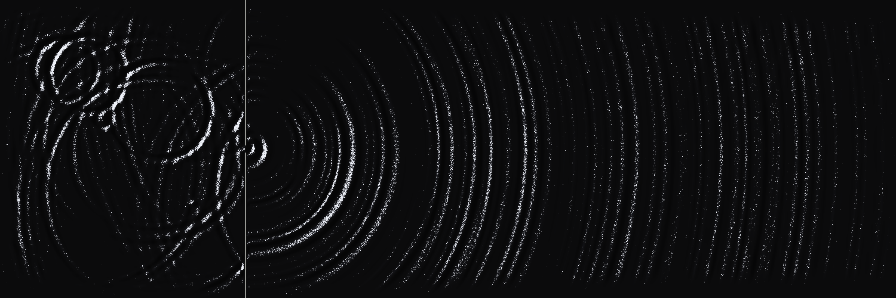

# One slit

A 2D wave equation, rendered with raking light, cast shadows and fixed grain.

**[Live demo](https://cnzn0.github.io/one-slit/)** · **[Eight-stage breakdown](https://cnzn0.github.io/one-slit/#1)**



The demo starts with the complete 1500 × 500 render. Select a breakdown stage
to inspect how it is built, or pause and scrub the same 120-frame loop.
Each stage includes an equation and a written explanation. Reduced-motion
preferences start playback paused.

## Run locally

No package installation or build step is needed. With Python 3 available:

```sh
python3 -m http.server 8000 --bind 127.0.0.1 --directory docs
```

Open `http://127.0.0.1:8000`. Use an HTTP server rather than opening `index.html`
directly, because the page loads JavaScript modules.

The interactive renderer requires WebGL2 and floating-point color attachments
(`EXT_color_buffer_float`). The browser computes the fields on load, so startup
can take a few seconds. Three R16F texture arrays use about 135 MB for cached
fields, plus render targets and CPU state. Lower-memory devices may show the
provided final still instead. Physical-device performance has not been benchmarked.

## The eight stages

| Stage | What it shows |
| --- | --- |
| 01 / Grid + state | A zero-height domain and the five-point spatial stencil. |
| 02 / Source pulses | Seventeen Ricker pulses in a wall-free diagnostic solve. |
| 03 / Wall + diffraction | A six-cell opening through a reflective barrier. |
| 04 / Display gain | Distance-based gain applied after the numerical solve. |
| 05 / Raking light | Surface normals derived from the height gradient. |
| 06 / Cast shadows | A height-field visibility mask and the shaded result. |
| 07 / Fixed grain | A stationary threshold texture and its light response. |
| 08 / Complete | All rendering passes together. |

## Solver

The continuous equation is `u_tt = c² ∇²u`. The code uses a five-point Laplacian
with unit grid spacing and a damped leapfrog update:

```text
lap = u_left + u_right + u_top + u_bottom - 4u
u_next = (2u - (1-d)u_previous + c² lap) / (1+d)
```

The 750 × 250 field advances four numerical steps per output frame. Here
`c² = 0.25` is the squared Courant number: `c Δt / Δx = 0.5`.
Missing neighbors at the barrier reuse the current cell, giving a reflective
boundary. A 26-cell damping margin absorbs energy near the outside edges.
The inclusive aperture interval `[122, 127]` is six cells wide.

Seventeen deterministic source events inject Ricker pulses into a cell and its
four neighbors. The forcing repeats every 480 steps. After three warm-up cycles,
the next 120 frames are cached. This is an approximation to a periodic steady
state, not a claim of mathematically exact equality at the loop boundary.

The renderer applies distance-based display gain, compresses the height range,
derives normals, samples cast shadows, then thresholds two samples of a fixed
grain texture. These display operations do not feed back into the solver.
The no-wall view in stage 02 is a second diagnostic solve; the other stages use
the barrier solve and its rendering passes.

## Source map

- `docs/engine.js` — numerical solver, source schedule, cached fields and GLSL passes.
- `docs/breakdown.js` — the eight explanatory canvas compositions.
- `docs/content.js` — equations and readable stage descriptions.
- `docs/app.js` — playback, stage selection, reduced motion and fallback behavior.
- `docs/index.html`, `docs/style.css` — the static demo interface.

For experiments, start with `GAP` (aperture), `ARR` (source schedule), `LAM`
(nominal wavelength), `az` / `el` (light direction), and `grainTex` (texture).
Keep the simulation grid, numerical stability and rendering dimensions in mind
when changing constants. This is a visual study, not a validated scientific model.

The standalone version preserves the original One slit renderer and its eight
diagnostic compositions, with a new static interface and capability checks.
All wave and grain data are generated procedurally.

## Hosting and privacy

GitHub Pages serves the `docs/` directory from `main`. The demo has no backend,
accounts, uploads, analytics, cookies, local storage, or third-party runtime requests.
All scripts, the font and the preview image are served from this repository.
The page's content security policy blocks script-initiated network connections,
inline scripts and embedded objects. GitHub's hosting infrastructure still
receives ordinary page and asset requests; see GitHub's privacy statement.

## License

Code and original project assets: [MIT](LICENSE), copyright 2026 cnzn0.
Keep the copyright and permission notice when reusing substantial portions.
The bundled Geist Mono font has its own [SIL OFL 1.1 license](docs/assets/OFL.txt).
See [third-party notices](THIRD_PARTY_NOTICES.md).
